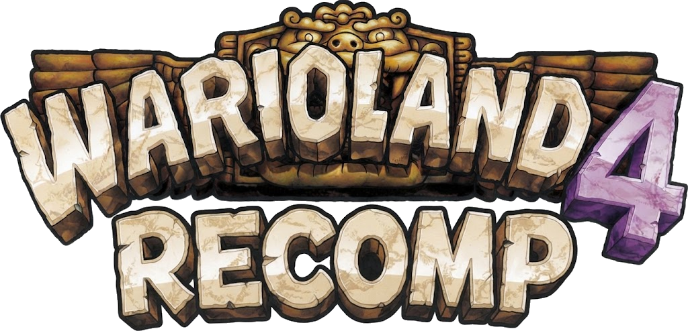
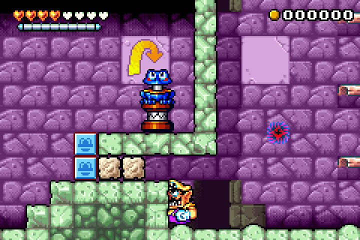
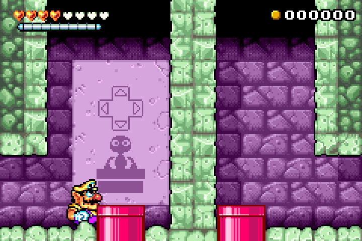

<p align="center">
  
</p>

<h1 align="center">wl4-recomp</h1>

<p align="center">
  <b>Wario Land 4, running natively on Android and Linux.</b><br>
  No emulator: the game's own C code, compiled for your device, with save states, touch controls and rumble.
</p>

<p align="center">
  <a href="https://github.com/kalasyan/wl4-recomp/actions/workflows/build.yml"></a>
  
  
  
  
</p>

---

## ✨ What is this?

**wl4-recomp** turns *Wario Land 4* (GBA) into a native app for Android and PC.
It is built from the [warioland4](https://github.com/TsilaAllaoui/warioland4)
decompilation and the native PC port of
[BioRhythmicStudios](https://github.com/BioRhythmicStudios/warioland4): the game
code is compiled as C for the device and runs on a small model of the GBA
hardware, with the SDL3 frontend of its sister projects,
[metroid-zm-recomp](https://github.com/kalasyan/metroid-zm-recomp),
[metroid-fs-recomp](https://github.com/kalasyan/metroid-fs-recomp) and
[fire-emblem-ss-recomp](https://github.com/kalasyan/fire-emblem-ss-recomp).

The graphics, sound and text are read from **your own ROM** at startup, so the
repository and the APK contain no game data.

> 🤖 **AI notice:** this project was developed with the help of AI tools
> (Anthropic's Claude), which wrote most of the code and documentation under
> my direction and review.

## 📸 Screenshots

<p align="center">
  
  
</p>

## 🎮 Features

- 📱 **Native Android app**, with a touch gamepad you can rearrange and resize.
- 💾 **Quick saves:** slots with thumbnail and date (`F5` / `F8`), on top of the normal in-game save.
- 🎨 **Video options:** fullscreen, integer scaling, smooth filter, LCD grid or CRT scanlines, VSync.
- 🌊 **Smoothness options:** match the game speed to 60/120 Hz displays, or frame blending for 90/144 Hz.
- ⏩ **Fast-forward** (x2 to x10, hold or toggle).
- 🎮 **Keyboard and gamepad** with remappable buttons, and **rumble** when Wario takes a hit, smashes blocks or hits the frog switch.
- 🔊 **The original sound engine**, translated to C.
- 🚫 **No BIOS and no emulator needed.**

## 📊 Status

- The whole game is C: the decompilation is complete, and the port runs it on
  x86-64 and on 64-bit ARM (Android) with the same frames on both.
- Tested on PC and on ARM under qemu: the intro, the title, the passages and
  the first levels, the in-game save, and quick saves.
- 🚧 It still needs testing on real Android devices and a full playthrough.
  Quick saves are refused during cutscenes (the game must be in its main
  loop). How it works: [docs/PORT.md](docs/PORT.md).

## 💽 You need your own ROM

The USA and European releases are the same cartridge:

| Region | File | MD5 |
|---|---|---|
| USA, Europe | Wario Land 4 (USA, Europe) | `5fe47355a33e3fabec2a1607af88a404` |

## 🚀 Installation (Android)

Download `Wario_Land_4-<version>.apk` from the
**[latest release](https://github.com/kalasyan/wl4-recomp/releases/latest)**,
install it and pick your ROM when you open it. ▶️

Every change to `main` is published as a new release, so you can also add
`https://github.com/kalasyan/wl4-recomp` to
[Obtainium](https://github.com/ImranR98/Obtainium) and get updates as they
come out.

The builds are also in
**[Actions → build](https://github.com/kalasyan/wl4-recomp/actions/workflows/build.yml)**
(the `wl4-android-apk` artifact of each run).

## 🕹️ Controls

> 💡 The **options menu** pauses the game and opens with **Esc** (or the
> Android back button). From there you can remap every button, manage quick
> saves, change the video filter, set the fast-forward speed and edit the
> touch controls.

| GBA | Keyboard |
| --- | --- |
| A / B | X / Z |
| L / R | A / S |
| Start / Select | Enter / Backspace |
| D-pad | arrow keys |
| Fast-forward | Tab |
| Quick save / load | F5 / F8 |

## 🔨 Building from source

### Android

You need JDK 17 and the Android SDK with NDK 27.2.12479018:

```sh
cd android
./gradlew assembleRelease
```

### Linux

You need CMake, Ninja and Clang. SDL3 and Dear ImGui are downloaded
automatically.

```sh
cmake -B build -G Ninja -DCMAKE_C_COMPILER=clang -DCMAKE_CXX_COMPILER=clang++
ninja -C build
./build/wl4 [path/to/rom.gba]
```

Without a path, the game uses the ROM it was given last time, looks for
`baserom_us.gba` next to the executable, or opens a file picker.
`wl4_headless` runs the game without a window, for tests and comparisons with
mGBA; [docs/PORT.md](docs/PORT.md) has its options and the AArch64 build.

### GBA ROM (decompilation)

The decompilation tree still builds the original ROM, byte for byte, with
[agbcc](https://github.com/pret/agbcc) and `binutils-arm-none-eabi`; see the
[decompilation's README](https://github.com/TsilaAllaoui/warioland4#readme).
The port's changes are under `#ifdef PORTABLE`, so they do not affect that build.

## 🙏 Credits and license

- Decompilation: [lilDavid/warioland4](https://github.com/lilDavid/warioland4)
  and [TsilaAllaoui/warioland4](https://github.com/TsilaAllaoui/warioland4).
- Native PC port (64-bit game code, GBA memory map, I/O traps, software PPU
  and sound): [BioRhythmicStudios/warioland4](https://github.com/BioRhythmicStudios/warioland4).
- Everything is under the MIT license ([LICENSE](LICENSE)); SDL3 is under the
  zlib license and minicoro under MIT/Unlicense.

Wario Land 4 is a trademark of Nintendo. This project is not affiliated with
Nintendo and does not distribute any game data.
